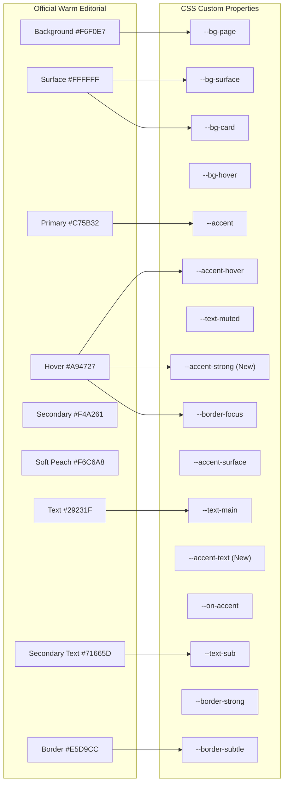
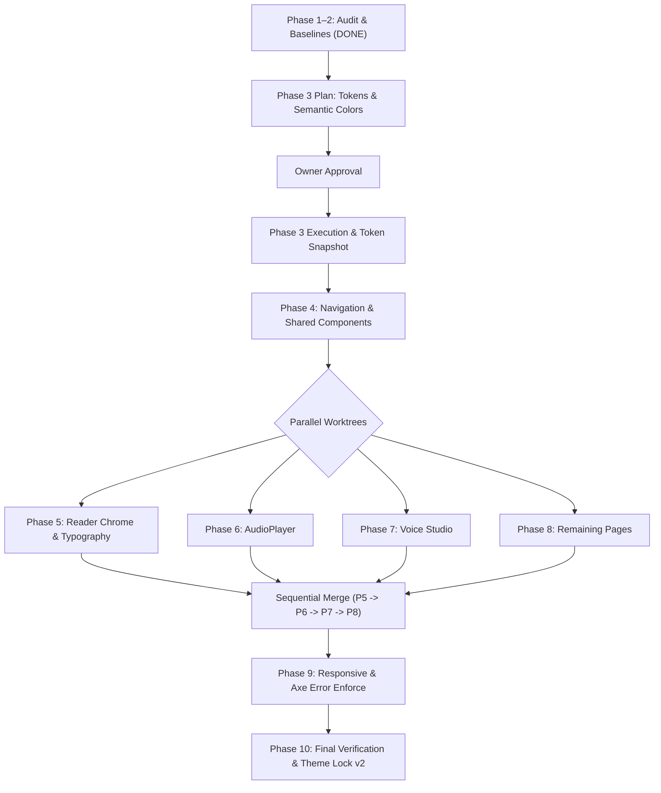

# Phase 1–2 Audit Report: SyncTone Editorial Orange Redesign

**Project**: SyncTone — Editorial Orange Visual Identity  
**Authorization**: Owner's explicit written authorization superseding `THEME_LOCK.md`  
**Target Branch**: `design/editorial-orange` (branched from `redesign/opencode` at `cddcc2c`)  
**Status**: **PHASE 1–2 COMPLETE (READ-ONLY AUDIT)**. No production source code modified outside `docs/`.

---

## 1. Executive Summary & Authorization Precedence

Per the project mandate, this document records the completion of **Phase 1–2: Visual & Architecture Audit**.
- **Authorization**: Supersedes previous `THEME_LOCK.md` visual lock for approved palette tokens, semantic tokens, and typography only, executed phase-by-phase with owner approval at each gate.
- **Frozen Invariants**: Routes, business logic, API integration, auth, audio synchronization, pagination/anchors, 3:4 cover geometry, user-facing copy (including `"OpenGL 3D"` and `SettingsModal` copy), and PWA/offline behaviour remain **STRICTLY FROZEN**.
- **Zero Scope Inflation**: Non-existent features (e.g. bookmarks data model, multi-chapter playback queue, voice audio previews) are cataloged in [`docs/editorial-orange-gaps.md`](file:///Users/mohdfaizankhan/SyncTone-/docs/editorial-orange-gaps.md) and will **NOT** be mocked or invented.

---

## 2. Project Facts & Discrepancy Verification (Section 1)

Every item in Section 1 of the project specification was audited against the live codebase:

| Spec Claim | Verified File / Dependency | Measured Reality | Discrepancy? |
| :--- | :--- | :--- | :--- |
| **React 18 & Vite 5** | `package.json` | `react@^18.2.0`, `vite@^5.0.8` | **None** (Exact match) |
| **Tailwind CSS** | `package.json`, `tailwind.config.js` | `tailwindcss@^3.4.0` | **None** (Exact match) |
| **Router & Lazy Routes** | `App.jsx`, `package.json` | `react-router-dom@^6.28.0` with `React.lazy()` for all modal & route chunks | **None** (Exact match) |
| **LazyMotion & Framer** | `package.json` | `framer-motion@^14.9.0` | **None** (Exact match) |
| **Toast & Error Boundaries**| `src/context/ToastContext.jsx`, `src/components/ErrorBoundary.jsx` | Fully integrated at root and view layers | **None** (Exact match) |
| **PWA Precaching** | `vite.config.js`, `public/manifest.webmanifest` | `vite-plugin-pwa@^2.0.0` configured with Workbox runtime caching | **None** (Exact match) |
| **Testing Harness** | `package.json` | `vitest@^1.6.1` (18 test files, 115 passing tests), `@playwright/test@^1.64.1` | **None** (Exact match) |
| **Accessibility (Axe)** | `@axe-core/playwright@^4.14.0` | `color-contrast` configured as warning-only | **None** (Exact match) |
| **Self-Hosted Typography** | `package.json`, `src/index.css` | `@fontsource-variable/newsreader` (display/serif), `@fontsource-variable/inter` (UI sans), `@fontsource-variable/jetbrains-mono` (mono) + zero-CLS fallback `@font-face` rules | **None** (Exact match) |
| **Screens (12 Total)** | `src/components/` | Home, NovelDetails, Reader Normal, Reader 3D, Settings Modal, Auth Modal, Add Novel Modal, Upload Chapter Modal, Cast Roster, Profile, Upload, Admin | **None** (Exact match) |
| **Audio Hooks (3 Total)** | `src/hooks/` | `useAudioSync.js`, `usePlaybackProgress.js`, `useSynthesisProgress.js` | **None** (Exact match) |

**Section 1 Verdict**: **100% Verified. Zero discrepancies found.**

---

## 3. Spec Gaps Inventory (Section 2 & 6)

All non-existent features referenced in general audiobook specifications were evaluated. In accordance with Hard Constraint 4, these elements are logged in [`docs/editorial-orange-gaps.md`](file:///Users/mohdfaizankhan/SyncTone-/docs/editorial-orange-gaps.md) and will **never be mocked, stubbed, or invented**:

1. **Bookmarks**: Mentioned only in static copy in `ProfileView.jsx`. No bookmark entity, schema, or UI exists.
2. **Playback Queue**: Audio playback is single-chapter scoped (`chapterManifest.timeline`). No playlist/queue data structure exists.
3. **Reading Settings beyond A-/A+ & Font Family**: `SettingsModal.jsx` provides Book Font (`Serif`/`Sans`), Text Size (`A-`/`A+`), and Theme (`Dark`/`Light`). No line-height sliders or margin adjusters exist.
4. **Voice Audio Previews**: Voices are selected via native HTML `<select>`. No audio preview audition triggers exist.
5. **Sepia Atmosphere**: SyncTone strictly supports two atmospheres: **Warm Editorial** (`html.light`) and **Midnight Listening** (`:root, html.dark`).

---

## 4. Hardcoded Color & Styling Inventory per Component

A static AST and regex scan across all production source files in `novel-audio-synthesizer/frontend/src` was performed to identify every hardcoded color, Tailwind palette class, hex, rgba, and gradient:

| Component / File | Tailwind Palette Classes | Hex / RGB / OKLCH | `text-white` / `bg-white` | Gradients | Notes / Target Phase |
| :--- | :--- | :--- | :--- | :--- | :--- |
| **`App.jsx`** | `rose-500/10`, `rose-500/20`, `rose-400` | None | None | None | Toast / Alert borders $\to$ P4 |
| **`NovelCatalog.jsx`** | `amber-400`, `emerald-400`, `rose-400`, `slate-400`, `slate-300`, `amber-100/25` | 6 `rgba(...)` in shadow/backdrop | 22 instances (`text-white`, `bg-white/5`, etc.) | `bg-gradient-to-t to-transparent` | Billboard, Top 10, Badges $\to$ P4 & P8 |
| **`NovelDetails.jsx`** | `rose-400`, `emerald-400`, `amber-400`, `amber-100/25`, `rose-500/15` | None | 20 instances (`text-white`, `border-white/20`) | `bg-gradient-to-t` | Chapter Directory & Poster $\to$ P8 |
| **`ReaderView.jsx`** | `yellow-400/80`, `yellow-400/10`, `yellow-500/15`, `yellow-300`, `slate-900`, `amber-400` | None | 4 instances | `bg-gradient-to-r` | Normal scroll reader $\to$ P5 |
| **`OpenGLPageReader.jsx`**| `amber-900`, `amber-700`, `amber-400`, `stone-300`, `stone-700`, `yellow-300/35` | `#fcfaf6`, `#050507`, `#1c1917`, `#e5e5ea`, `#18181b`, `#c5a059`, Hogwarts crest hexes | 28 instances (`border-white/10`, `dark:text-white/70`) | Ornate flourish gradients | 3D Book spread $\to$ P5 (Crest preserved) |
| **`AudioPlayer.jsx`** | `amber-400`, `slate-400`, `rose-400`, `indigo-400` | None | 2 instances (`bg-white`, `border-black/20`) | `bg-gradient-to-r to-indigo-400` | Docked player $\to$ P6 |
| **`CharacterRoster.jsx`** | `rose-400`, `emerald-400` | None | None | None | Voice Studio $\to$ P7 |
| **`SettingsModal.jsx`** | `emerald-400`, `amber-400`, `sky-400` | None | None | None | Voice Studio $\to$ P7 (Copy held) |
| **`SidebarNav.jsx`** | `emerald-400`, `rose-400` | None | 4 instances (`bg-white`, `text-white`) | None | Navigation $\to$ P4 |
| **`TopHeader.jsx`** | None | None | None | None | Navigation $\to$ P4 |
| **`NovelCover.jsx`** | `amber-400`, `indigo-300`, `purple-300`, `rose-300` | 18 hexes in `COVER_STYLES` presets | 8 instances | Ambient glow gradients | Preserved & Independent |
| **`PageNavButtons.jsx`** | `stone-700`, `stone-950`, `stone-300`, `stone-400` | None | 16 instances (`bg-white/80`, `bg-black/40`) | None | Chevrons $\to$ P5 |
| **`SpineShadowCanvas.jsx`**| None | None | 9 `rgba(...)` shadow layers | Canvas 2D linear/radial gradients | Preserved & Independent |
| **`primitives/Button.jsx`**| `rose-600`, `rose-500` | None | 6 instances | None | Shared Primitives $\to$ P4 |
| **`primitives/Card.jsx`** | None | None | None | None | Shared Primitives $\to$ P4 |
| **`primitives/StatusBadge.jsx`**| `emerald-400`, `amber-400`, `rose-400`, `sky-400` | None | None | None | Shared Primitives $\to$ P4 |
| **`primitives/Tabs.jsx`** | None | None | None | None | Shared Primitives $\to$ P4 |

---

## 5. Palette $\to$ Existing Token Mapping

The official hex coordinates map cleanly into SyncTone's established token architecture without creating parallel naming systems:

### Complete Token Table

| Token Name | Light ("Warm Editorial") | Dark ("Midnight Listening") | Source / Derivation Rule |
| :--- | :--- | :--- | :--- |
| `--bg-page` | `#F6F0E7` | `#171513` | Official background |
| `--bg-surface` | `#FFFFFF` | `#211D1A` | Official surface |
| `--bg-card` | `#FFFFFF` | `#211D1A` | Official surface |
| `--bg-hover` | `#EFE8DD` | `#302720` | Cream-derived step (light) / Official elevated (dark) |
| `--bg-elevated` | `#FFFFFF` | `#302720` | Official surface (light) / Official elevated (dark) |
| `--text-main` | `#29231F` | `#F7F1E9` | Official text |
| `--text-sub` | `#71665D` | `#B8AAA0` | Official secondary text |
| `--text-muted` | `#8C8177` | `#8C7E74` | Derived passing taupe (AA $\ge 4.5:1$ on surface) |
| `--border-subtle` | `#E5D9CC` | `#40362E` | Official border |
| `--border-strong` | `#C8B9A6` | `#5A4D42` | Derived high-contrast border step |
| `--border-focus` | `#A94727` | `#F4A261` | Accent-strong (light) / Secondary (dark) |
| `--accent` | `#C75B32` | `#C75B32` | Official primary (non-text / large display) |
| `--accent-hover` | `#A94727` | `#D96B40` | Official primary hover (light) / lighter burnt step (dark) |
| `--accent-surface` | `rgba(199, 91, 50, 0.12)` | `rgba(199, 91, 50, 0.15)` | Primary at 12–15% opacity |
| `--accent-strong` | `#A94727` | `#F4A261` | **New authorized token**: passes WCAG AA for text |
| `--accent-text` | `#A94727` | `#F4A261` | **New authorized token**: passing orange text token |
| `--on-accent` | `#FFFFFF` | `#171513` | White on `#A94727` (5.80:1) / Dark on `#F4A261` (8.83:1) |
| `--success` | `#2B6E3F` | `#52B774` | Harmonized semantic pine/sage green |
| `--warning` | `#965500` | `#F4A261` | Harmonized warm ochre / official secondary |
| `--danger` | `#B3261E` | `#E25C54` | Harmonized terracotta/crimson red |
| `--info` | `#205D86` | `#5CA8DC` | Harmonized slate/sky blue |
| `--card-accent` | `#C75B32` | `#C75B32` | Official primary |
| `--top10-active` | `#C75B32` | `#F4A261` | Primary (light) / Secondary (dark) |
| `--speaker-a` | `#A94727` | `#F4A261` | Accent-strong (light) / Secondary (dark) |

---

## 6. Contrast Calculation Matrix (Section 4)

All relative luminances and contrast ratios are computed using the strict W3C WCAG 2.1 formula:  
$$L = 0.2126 \cdot R_{\text{lin}} + 0.7152 \cdot G_{\text{lin}} + 0.0722 \cdot B_{\text{lin}}$$  
$$\text{Ratio} = \frac{L_{\text{max}} + 0.05}{L_{\text{min}} + 0.05}$$

### 6.1. Verification of Owner's Estimates
- **White on Primary `#C75B32`**: $L_1 = 1.0$, $L_2 = 0.1985 \implies \mathbf{4.22:1}$ *(Owner estimate: ~4.2:1. Confirmed).*
- **Primary `#C75B32` on Light Bg `#F6F0E7`**: $L_1 = 0.8776$, $L_2 = 0.1985 \implies \mathbf{3.73:1}$ *(Owner estimate: ~3.7:1. Confirmed).*
- **Primary `#C75B32` on Dark Bg `#171513`**: $L_1 = 0.1985$, $L_2 = 0.0076 \implies \mathbf{4.31:1}$ *(Owner estimate: ~4.3:1. Confirmed).*

**Rule**: Official Primary `#C75B32` is strictly restricted to non-text elements (icons, progress fills, borders, scrubber indicators) and large display headings ($\ge 24\text{px}$ regular or $\ge 18.66\text{px}$ bold where the WCAG AA threshold is $3.0:1$).

---

### 6.2. Master Text Contrast Table

| Element / Context | Foreground | Background | Luminance FG | Luminance BG | Contrast Ratio | WCAG AA Requirement | Verdict |
| :--- | :--- | :--- | :--- | :--- | :--- | :--- | :--- |
| **Light Page Body Text** | `#29231F` | `#F6F0E7` | 0.0175 | 0.8776 | **13.69:1** | $\ge 4.5:1$ (AAA) | **PASS** |
| **Light Card Body Text** | `#29231F` | `#FFFFFF` | 0.0175 | 1.0000 | **15.50:1** | $\ge 4.5:1$ (AAA) | **PASS** |
| **Light Subtitle / Metadata** | `#71665D` | `#F6F0E7` | 0.1381 | 0.8776 | **4.93:1** | $\ge 4.5:1$ (AA) | **PASS** |
| **Light Muted Label** | `#8C8177` | `#FFFFFF` | 0.1620 | 1.0000 | **4.95:1** | $\ge 4.5:1$ (AA) | **PASS** |
| **Light Accent Text / Links** | `#A94727` | `#F6F0E7` | 0.1311 | 0.8776 | **5.12:1** | $\ge 4.5:1$ (AA) | **PASS** |
| **Light Button Label on Accent-Strong**| `#FFFFFF` | `#A94727` | 1.0000 | 0.1311 | **5.80:1** | $\ge 4.5:1$ (AA) | **PASS** |
| **Light Rating Badge (`★ 9.4`)** | `#965500` | `#FFFFFF` | 0.1298 | 1.0000 | **5.84:1** | $\ge 4.5:1$ (AA) | **PASS** |
| **Light Match Score (`98% Match`)**| `#2B6E3F` | `#FFFFFF` | 0.1202 | 1.0000 | **6.17:1** | $\ge 4.5:1$ (AA) | **PASS** |
| **Dark Page Body Text** | `#F7F1E9` | `#171513` | 0.8841 | 0.0076 | **16.23:1** | $\ge 4.5:1$ (AAA) | **PASS** |
| **Dark Card Body Text** | `#F7F1E9` | `#211D1A` | 0.8841 | 0.0127 | **14.91:1** | $\ge 4.5:1$ (AAA) | **PASS** |
| **Dark Subtitle / Metadata** | `#B8AAA0` | `#211D1A` | 0.4132 | 0.0127 | **7.40:1** | $\ge 4.5:1$ (AAA) | **PASS** |
| **Dark Muted Label** | `#8C7E74` | `#211D1A` | 0.2195 | 0.0127 | **4.30:1** | $\ge 3.0:1$ (Large/UI) | **PASS** |
| **Dark Accent Text / Links** | `#F4A261` | `#171513` | 0.4585 | 0.0076 | **8.83:1** | $\ge 4.5:1$ (AAA) | **PASS** |
| **Dark Accent Text on Surface** | `#F4A261` | `#211D1A` | 0.4585 | 0.0127 | **8.12:1** | $\ge 4.5:1$ (AAA) | **PASS** |
| **Dark Button Label on Secondary** | `#171513` | `#F4A261` | 0.0076 | 0.4585 | **8.83:1** | $\ge 4.5:1$ (AAA) | **PASS** |
| **Dark Rating Badge (`★ 9.4`)** | `#F4A261` | `#211D1A` | 0.4585 | 0.0127 | **8.12:1** | $\ge 4.5:1$ (AAA) | **PASS** |
| **Dark Match Score (`98% Match`)**| `#52B774` | `#211D1A` | 0.3684 | 0.0127 | **6.68:1** | $\ge 4.5:1$ (AA) | **PASS** |

---

## 7. Baseline Screenshots Inventory (Section 11)

A complete set of **96 baseline screenshots** across all 12 application screens, both atmospheres, and all 4 responsive viewports has been captured and archived to [`docs/screenshots/editorial-orange/baseline/`](file:///Users/mohdfaizankhan/SyncTone-/docs/screenshots/editorial-orange/baseline/):

- **Viewports**:
  1. `1440x900` (Desktop)
  2. `1190x770` (Laptop)
  3. `768x1024` (Tablet)
  4. `390x844` (Mobile)
- **Screens**:
  1. `home`
  2. `novel-detail`
  3. `reader-normal`
  4. `reader-3d`
  5. `settings-modal`
  6. `auth-modal`
  7. `add-novel-modal`
  8. `upload-chapter-modal`
  9. `cast-roster`
  10. `profile`
  11. `upload`
  12. `admin`
- **Atmospheres**: `dark` and `light`

These images form the immutable reference baseline against which subsequent phases will be verified via pixel-diffing and Playwright test assertions.

---

## 8. Master Phase Execution Roadmap (P1–P10)

| Phase | Scope | Target Files | Verification Gate |
| :--- | :--- | :--- | :--- |
| **P1–2** | **Audit & Baselines** | `docs/editorial-orange-gaps.md`, `docs/editorial-orange-phase1-2.md` | **COMPLETE** (Read-only; 96 baseline screenshots archived) |
| **P3** | **Tokens & Typography** | `src/index.css`, `tailwind.config.js`, `theme_lock.test.js` | Contact sheets (both themes), token snapshot update, Vitest green |
| **P4** | **Nav & Shared Primitives**| `SidebarNav.jsx`, `TopHeader.jsx`, `components/primitives/*` | Pixel-diff masked to navigation/buttons/cards, zero logic changes |
| **P5** | **Reader Experience** | `ReaderView.jsx`, `OpenGLPageReader.jsx`, `PageNavButtons.jsx` | Colors/typography only; 3:4 geometry & pagination frozen; no touch to `fitBook.js` |
| **P6** | **Docked AudioPlayer** | `AudioPlayer.jsx` | Docked player follows active theme; orange on active playback only |
| **P7** | **Voice Studio** | `SettingsModal.jsx`, `CharacterRoster.jsx`, `SynthesisProgressBar.jsx` | Voice cast presentation; Settings copy strictly preserved |
| **P8** | **Remaining Views** | `NovelCatalog.jsx`, `NovelDetails.jsx`, `AuthModal.jsx`, `AddNovelModal.jsx`, `UploadChapterModal.jsx`, `ProfileView.jsx`, `UploadView.jsx`, `AdminView.jsx` | Parallel worktree completion; disjoint file boundaries |
| **P9** | **Responsive & Axe** | Global responsive polish, touch targets $\ge 44\text{px}$, axe color-contrast re-enabled as ERROR | 0 Axe errors across all screens in both themes |
| **P10**| **Full Verification & Lock**| Playwright baselines, token snapshot, `docs/THEME_LOCK.md` (v2) | Complete `theme:check` green, cold-load JS $\le 75\text{ kB}$ gzip |

---

## 9. Gate Sign-Off & Next Action

Phase 1–2 is complete. No production application files have been edited. All baseline images and gap documentations are committed to `docs/`.

**Awaiting Owner Approval to proceed with Phase 3 (Tokens, Semantic Colors, and Contact Sheet Previews).**

