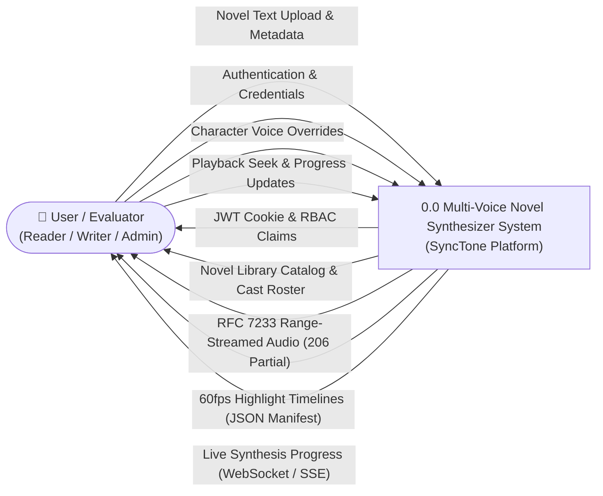
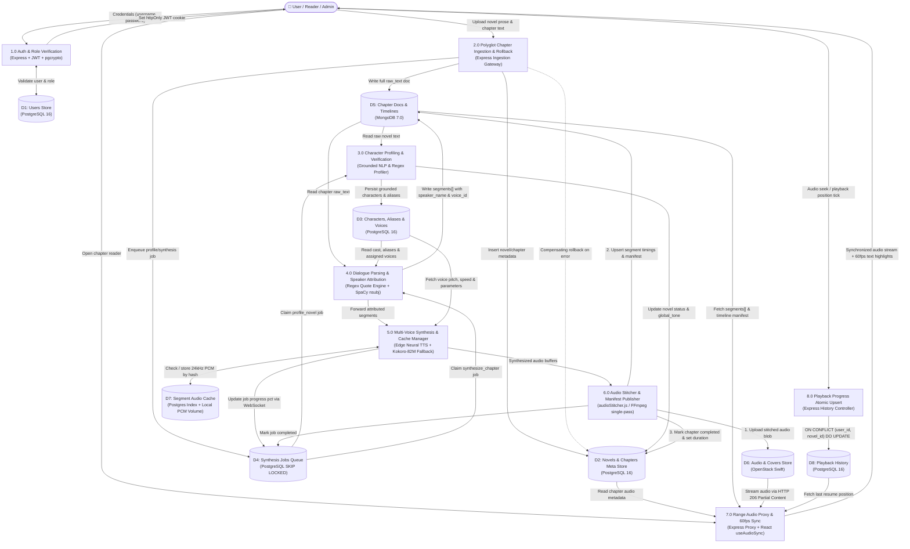
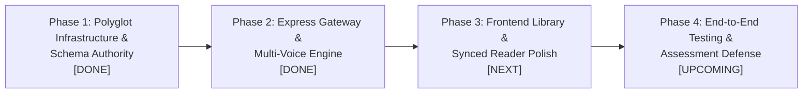

# SyncTone — Multi-Voice Novel Synthesizer System Architecture

SyncTone is an enterprise-grade, polyglot AI-assisted novel audiobook synthesis platform. It transforms plain narrative text into multi-voice dramatized audiobooks with sample-accurate, 60fps-synchronized reading highlighted in real time.

---

## 1. Tech Stack & System Infrastructure

SyncTone is deployed as a 6-service polyglot architecture orchestrated via Docker Compose:

| Layer | Technology | Version / Spec | Role & Academic / Engineering Justification |
|---|---|---|---|
| **Frontend Web Client** | **React 18 + Vite 5** | Pure JS (ES2022+), Tailwind CSS 3 | High-performance reactive Single-Page Application (SPA) designed for responsive webnovel reading (WTR-Lab style). Employs a zero-stutter 60fps `requestAnimationFrame` polling loop coupled with a binary-search `useAudioSync` hook for continuous audio-to-text highlight synchronization. Consumes live synthesis progress via WebSocket. |
| **Input Sanitization** | **`tts-dom-cleaner`** | npm package | Client-side DOM and text cleaner that strips web novel artifacts (site navigation, author notes, sponsor links, ruby tags) before server submission. |
| **API Gateway & Primary Synthesis** | **Node.js 20+ & Express.js** | CommonJS + Prisma ORM | High-throughput asynchronous REST API Gateway and primary orchestration engine. Implements `httpOnly` cookie JWT authentication with `pgcrypto` bcrypt hashing, role-based access control (RBAC: `reader`, `writer`, `admin`), **Prisma ORM** (`prisma/schema.prisma` + `@prisma/client`) layered over PostgreSQL alongside connection-pooled queries (`pg`), MongoDB ODM (`mongoose`), dialogue parsing (`textParser.js`), speaker attribution (`attribution.js`), voice profiling (`voiceProfiler.js`), audio stitching (`audioStitcher.js`), and RFC 7233 OpenStack Swift Range Streaming Proxy. |
| **Primary Cloud TTS Engine** | **Microsoft Edge Neural TTS** | `msedge-tts` (24kHz 48kbps MP3) | Primary multi-voice neural synthesis engine providing authentic, expressive character casting (e.g., British voices for Harry Potter: `en-GB-ThomasNeural`, `en-GB-LibbyNeural`, `en-GB-AlfieNeural`, `en-GB-ArthurNeural`, `en-GB-NoahNeural`, `en-GB-RyanNeural`). Yields natural prosody with sub-second per-segment latency. |
| **Offline Worker Daemon & Schema Authority** | **Python 3.11 (`kokoro-tts-backend`)** | SQLAlchemy 2.0, Alembic, SpaCy | Decoupled background worker daemon and authoritative schema migration runner (`0001_initial_schema.py` $\rightarrow$ `0003_enforce_4nf.py`). Uses SpaCy (`en_core_web_sm`) dependency parsing for offline speaker resolution and Kokoro-82M ONNX / PyTorch TTS for zero-network, local harmonic fallback synthesis. Worker claims background jobs atomically via `SELECT ... FOR UPDATE SKIP LOCKED`. |
| **Relational Database (Core Authority)** | **PostgreSQL 16 (`synctone-postgres`)** | Alpine Docker container, Port 5432 | **Strict Fourth Normal Form (4NF)** relational DBMS (12 normalized tables) serving as the authoritative single source of truth for identity, RBAC, novel catalog metadata, character portfolios, aliases, voice catalog (20 seeded voices: 12 Kokoro + 8 Edge Neural), subtype-decomposed transactional job queue (`synthesis_jobs`, `novel_profile_job_targets`, `chapter_synthesis_job_targets`), LRU segment audio cache (`segment_audio_cache`), and decomposed atomic playback resume (`playback_history` + `playback_positions` + `reading_progress` view). |
| **Document Database (Chapter Prose & Timelines)** | **MongoDB 7.0 (`synctone-mongo`)** | Official Docker container, Port 27017 | High-performance document store (`chapters` collection via Mongoose `Chapter` model) linked to PostgreSQL via `pg_chapter_id` (UUID unique index). Stores full raw prose, attributed dialogue/narration segment arrays (with `order`, `segment_id`, `type`, `text`, `character_id`, `speaker_id`, `speaker_name`, `voice_id`, `confidence`, `source`, `needs_review`), and pre-calculated playback manifest timelines (`total_duration_ms`, `audio_url`, `timeline[]`). |
| **Distributed Object Storage** | **OpenStack Swift (`synctone-swift`)** | `bouncestorage/swift-aio`, Port 8080 | Multi-tenant distributed object store managing binary audio blobs in container `novel-chapters` and book artwork in `novel-covers`. Streamed directly to browser `<audio>` elements via the Express Range Proxy (`GET /api/chapters/:id/audio` and `GET /api/stream/:chapter_id`) with HTTP 206 Partial Content, automatic 401 token refresh retry, and 416 range validation. |

---

## 2. Verified Entity-Relationship (ER) Diagram (Strict 4NF)

The data layer follows a **Polyglot Persistence Model** with a strict boundary between relational metadata in PostgreSQL and rich hierarchical documents in MongoDB:
* **PostgreSQL 16** enforces **12 normalized Strict 4NF tables** with referential integrity, foreign key cascading, subtype target decomposition, and row-level locking.
* **MongoDB 7.0** encapsulates ordered, multi-second segment arrays and playback manifests per chapter, avoiding relational join overhead and high-frequency lock contention.

```mermaid
erDiagram
    USERS ||--o{ NOVELS : "adds (1:N)"
    USERS ||--o{ SYNTHESIS_JOBS : "requests (1:N)"
    USERS ||--o{ PLAYBACK_HISTORY : "maintains (1:N)"

    NOVELS ||--o{ CHAPTERS : "contains (1:N)"
    NOVELS ||--o{ CHARACTERS : "defines cast (1:N)"
    NOVELS ||--o{ NOVEL_PROFILE_JOB_TARGETS : "targets (1:N)"
    NOVELS ||--o{ PLAYBACK_HISTORY : "tracked in (1:N)"

    CHARACTERS ||--o{ CHARACTER_ALIASES : "known as (1:N)"
    VOICES ||--o{ CHARACTERS : "assigned to (1:N)"

    CHAPTERS ||--o{ CHAPTER_SYNTHESIS_JOB_TARGETS : "targets (1:N)"
    CHAPTERS ||--o{ PLAYBACK_POSITIONS : "current chapter (1:N)"
    CHAPTERS ||..|| MONGO_CHAPTER_DOC : "content link [pg_chapter_id] (1:1)"

    PLAYBACK_HISTORY ||--o| PLAYBACK_POSITIONS : "tracks offset (1:0..1)"
    SYNTHESIS_JOBS ||--o| NOVEL_PROFILE_JOB_TARGETS : "novel subtype (1:0..1)"
    SYNTHESIS_JOBS ||--o| CHAPTER_SYNTHESIS_JOB_TARGETS : "chapter subtype (1:0..1)"

    USERS {
        uuid id PK "gen_random_uuid()"
        varchar username UK "unique username"
        varchar email UK "unique email"
        varchar password_hash "bcrypt / pgcrypto"
        varchar role "reader, writer, admin"
        timestamptz created_at
        timestamptz updated_at
    }

    VOICES {
        varchar id PK "e.g. en-GB-ThomasNeural, am_adam"
        varchar label "Human-readable label"
        varchar gender "male, female"
        varchar age_band "child, young, adult, elder"
        varchar language "en-us, en-gb"
        boolean reserved_narrator "true for default narrator"
        timestamptz created_at
    }

    NOVELS {
        uuid id PK "gen_random_uuid()"
        uuid added_by FK "references users(id)"
        varchar title "Novel title"
        text synopsis "Description / blurb"
        varchar channel "verified, community"
        varchar status "draft, profiling, published, archived"
        varchar global_tone "whimsical, dark, epic, etc."
        varchar portfolio_source "manual, ai"
        varchar cover_object "Swift object key"
        timestamptz created_at
        timestamptz updated_at
    }

    CHAPTERS {
        uuid id PK "gen_random_uuid()"
        uuid novel_id FK "references novels(id)"
        int chapter_number "Composite UK (novel_id, chapter_number)"
        varchar title "Chapter title"
        varchar status "draft, parsed, synthesizing, completed, outdated, failed"
        int audio_version "Monotonic audio version"
        varchar swift_audio_object "Path in Swift novel-chapters"
        int total_duration_ms "Authoritative audio duration"
        timestamptz created_at
        timestamptz updated_at
    }

    CHARACTERS {
        uuid id PK "gen_random_uuid()"
        uuid novel_id FK "references novels(id)"
        varchar canonical_name "Composite UK (novel_id, canonical_name)"
        varchar gender "male, female, unknown"
        varchar age_band "child, young, adult, elder"
        varchar temperament "Character personality"
        text sample_quote "Verbatim grounded quote"
        varchar voice_id FK "references voices(id)"
        real speed_multiplier "0.5 to 2.0"
        boolean is_narrator "Partial UK on novel_id WHERE is_narrator"
        boolean needs_review "Flagged for human inspection"
        varchar source "manual, ai"
        timestamptz created_at
        timestamptz updated_at
    }

    CHARACTER_ALIASES {
        uuid id PK "gen_random_uuid()"
        uuid character_id FK "references characters(id)"
        varchar alias "Composite UK (character_id, alias)"
    }

    SYNTHESIS_JOBS {
        uuid id PK "gen_random_uuid()"
        uuid requested_by FK "references users(id) [nullable]"
        varchar job_type "profile_novel, synthesize_chapter"
        varchar status "queued, processing, completed, failed"
        real progress_pct "0.0 to 100.0"
        int attempts "Retry count"
        int max_attempts "Default: 3"
        timestamptz run_after "Exponential backoff timer"
        varchar worker_id "Active worker identifier"
        timestamptz locked_at "Heartbeat timestamp"
        text error_message "Failure diagnostics"
        timestamptz created_at
        timestamptz completed_at
    }

    NOVEL_PROFILE_JOB_TARGETS {
        uuid job_id PK_FK "references synthesis_jobs(id)"
        uuid novel_id FK "references novels(id)"
    }

    CHAPTER_SYNTHESIS_JOB_TARGETS {
        uuid job_id PK_FK "references synthesis_jobs(id)"
        uuid chapter_id FK "references chapters(id)"
    }

    SEGMENT_AUDIO_CACHE {
        varchar text_hash PK "SHA-256 text fingerprint"
        varchar voice_hash PK "Voice ID + speed multiplier hash"
        varchar local_pcm_path "File path to 24kHz raw PCM"
        int n_samples "Audio sample count"
        int sample_rate "Default: 24000 Hz"
        timestamptz last_used_at "LRU eviction index"
    }

    PLAYBACK_HISTORY {
        uuid id PK "gen_random_uuid()"
        uuid user_id FK "references users(id)"
        uuid novel_id FK "references novels(id)"
        timestamptz created_at "Composite UK (user_id, novel_id)"
    }

    PLAYBACK_POSITIONS {
        uuid history_id PK_FK "references playback_history(id)"
        uuid chapter_id FK "references chapters(id)"
        int segment_order "Last active segment sequence"
        int position_ms "Playback timestamp offset in ms"
        timestamptz updated_at "Atomic upsert timestamp"
    }

    MONGO_CHAPTER_DOC {
        ObjectId _id PK "MongoDB internal identifier"
        string pg_chapter_id UK "UUID foreign reference to chapters.id"
        string novel_id "Indexed foreign reference to novels.id"
        int chapter_number "Chapter index (1-based)"
        string title "Chapter title"
        string raw_text "Full, unparsed chapter prose"
        int audio_version "Monotonic audio version counter"
        array segments "Subdocuments: order, type, text, character_id, speaker_name, voice_id, confidence, source, needs_review, start_ms, end_ms"
        object manifest "Derived timeline and audio_url"
    }
```

### Key Database Architectural Rules & Constraints (Strict 4NF)
1. **Separation of Concerns**: Relational tables in PostgreSQL hold zero unparsed long prose or large JSON blobs; MongoDB holds no identity, billing, or cross-novel relational constraints.
2. **Deterministic Chapter & Character Ordering**: `UNIQUE(novel_id, chapter_number)` prevents duplicate chapters. `UNIQUE(novel_id, canonical_name)` guarantees character uniqueness per novel.
3. **Single Narrator Guarantee**: Partial unique index `CREATE UNIQUE INDEX uq_characters_narrator_per_novel ON characters(novel_id) WHERE is_narrator = true;` guarantees at most one narrator per book at the database engine level.
4. **3NF/4NF Alias Normalization (`CHARACTER_ALIASES`)**: Eliminates transitive `novel_id` redundancy (`character_id -> novel_id`) and enforces `UNIQUE(character_id, alias)` alongside a serialized database trigger (`fn_check_character_alias_novel_uniqueness`) preventing cross-character alias collisions within the same novel.
5. **4NF Job Subtype Decomposition (`SYNTHESIS_JOBS`)**: `synthesis_jobs` acts as a pure queue broker without nullable target columns, decomposing target bindings into `novel_profile_job_targets` and `chapter_synthesis_job_targets` enforced by deferred constraint triggers.
6. **4NF Playback Bookmark & Position Decomposition (`PLAYBACK_HISTORY` + `PLAYBACK_POSITIONS`)**: Separates user-novel bookmark identity (`playback_history`, `UNIQUE(user_id, novel_id)`) from mutable chapter/millisecond offset state (`playback_positions`, `1:0..1`), with compatibility views `v_playback_history` and `reading_progress`.
7. **Direct Reader Playback Optimization**: In `MONGO_CHAPTER_DOC`, each item in `segments[]` contains pre-resolved `voice_id` and `speaker_name` alongside `start_ms` and `end_ms`. This allows the React reader to highlight and display active dialogue instantly without making relational joins to PostgreSQL during playback.

---

## 3. Data Flow Diagrams (DFDs)

### 3.1 Level 0 DFD (Context Diagram)
The Level 0 diagram models the boundary between the external actors (Reader, Writer, Administrator, and Evaluator) and the Multi-Voice Novel Synthesizer platform.



---

### 3.2 Level 1 DFD (Verified Subsystem Data Flow)
This diagram defines the 8 architectural data stores ($D_1$ to $D_8$) and the 8 operational processes ($1.0$ to $8.0$). It maps the lifecycle of a chapter from raw text ingestion to speaker attribution, multi-voice synthesis, audio stitching, and 60fps synchronized playback.



---

## 4. 4-Phase Implementation Plan & Roadmap

The SyncTone implementation is structured into 4 sequential engineering phases to guarantee deterministic progress, robust data integrity, and verifiable milestone deliveries.



### Phase 1: Polyglot Infrastructure, 12-Table 4NF PG Schema & Mongoose Contract `[DONE]`
- [x] **6-Service Docker Compose Setup**: Configured and initialized `synctone-postgres` (PostgreSQL 16), `synctone-mongo` (MongoDB 7.0), `synctone-swift` (OpenStack Swift `bouncestorage/swift-aio`), `synctone-api` (Express Gateway), `synctone-worker` (Python Daemon), and `synctone-frontend` (React + Vite).
- [x] **Relational Schema Authority (PostgreSQL 16 — Strict 4NF)**: Implemented Alembic migrations (`0001_initial_schema.py` $\rightarrow$ `0002_enforce_strict_3nf.py` $\rightarrow$ `0003_enforce_4nf.py`) and Prisma ORM schema (`prisma/schema.prisma`) defining all **12 tables in Strict Fourth Normal Form (4NF)**:
  1. `users`: Identity and RBAC (`reader`, `writer`, `admin`) with unique constraints on `username` and `email`.
  2. `voices`: Master voice catalog with 20 pre-seeded voices (12 Kokoro + 8 Microsoft Edge Neural).
  3. `novels`: Catalog records with channel segmentation (`verified`, `community`) and lifecycle statuses.
  4. `chapters`: Relational metadata storing `total_duration_ms`, `swift_audio_object`, and `audio_version`.
  5. `characters`: Character cast portfolio with partial unique index ensuring at most one narrator per novel.
  6. `character_aliases`: 3NF/4NF alias normalization (`UNIQUE(character_id, alias)`) with trigger-enforced novel-scoped alias uniqueness.
  7. `synthesis_jobs`: Pure queue broker table supporting `SELECT ... FOR UPDATE SKIP LOCKED` and exponential backoff retry.
  8. `novel_profile_job_targets`: 4NF subtype target table binding `profile_novel` jobs to `novels(id)`.
  9. `chapter_synthesis_job_targets`: 4NF subtype target table binding `synthesize_chapter` jobs to `chapters(id)`.
  10. `segment_audio_cache`: LRU-indexed lookup table keyed by `(text_hash, voice_hash)` for 24kHz raw PCM buffers.
  11. `playback_history`: 4NF user-novel bookmark identity table (`UNIQUE(user_id, novel_id)`).
  12. `playback_positions`: 4NF mutable chapter/millisecond offset table (`history_id` PK) with compatibility views `v_playback_history` and `reading_progress`.
- [x] **Document Schema Contract (MongoDB 7.0)**: Defined Mongoose `Chapter` model in `novel-audio-synthesizer/backend/src/models/Chapter.js` keyed by unique `pg_chapter_id` UUID, storing full prose in `raw_text`, ordered `segments[]` (with `order`, `segment_id`, `type`, `text`, `character_id`, `speaker_id`, `speaker_name`, `voice_id`, `confidence`, `source`, `needs_review`), and `manifest` (`total_duration_ms`, `audio_url`, `timeline[]`).
- [x] **Database Verification Suite**: Created automated data engineering tests (`npm run test:de`) verifying check constraints, partial indexes, foreign key cascading, 3NF/4NF triggers, and state-dependent downgrade safety.

### Phase 2: Express Gateway, Auth/RBAC, Polyglot Ingestion, Multi-Voice Engine & Swift Range Proxy `[DONE]`
- [x] **Express.js API Gateway**: Implemented pure JavaScript (CommonJS, Node.js 20+) backend in `novel-audio-synthesizer/backend/` with zero transpilation build step.
- [x] **Authentication & RBAC Middleware**: Built `httpOnly` secure JWT cookie authentication with `pgcrypto` bcrypt password hashing and granular role authorization (`reader`, `writer`, `admin`).
- [x] **Polyglot Chapter Ingestion with Compensating Rollback**: Implemented atomic multi-database chapter creation in `POST /api/novels/:id/chapters`. Wraps PostgreSQL in an explicit SQL transaction (`BEGIN...COMMIT`) and compensates on failure by deleting the associated MongoDB document (`Chapter.deleteOne({ pg_chapter_id })`), preventing orphan records.
- [x] **Dual-TTS Multi-Voice Synthesis Engine**:
  - Primary Engine: Microsoft Edge Neural TTS (`msedge-tts`, 24kHz 48kbps MP3) streaming authentic British character voices (Harry, Hermione, Ron, Dumbledore, Snape, McGonagall, Ryan Narrator).
  - Fallback Engine: Python Kokoro-82M ONNX daemon in `kokoro-tts-backend/` providing local offline synthesis.
- [x] **Audio Stitcher (`audioStitcher.js`)**: Implemented sample-accurate MP3/WAV segment stitching that inserts 250ms inter-speaker silence frames and computes exact start/end millisecond timeline offsets.
- [x] **OpenStack Swift Range Proxy (`swift.js`)**: Developed RFC 7233 compliant streaming proxy (`GET /api/chapters/:id/audio` and `GET /api/stream/:chapter_id`) with single in-flight token refresh mutex, 401 automatic re-authentication retry, 416 range validation, HTTP 206 Partial Content delivery, and local filesystem fallback.
- [x] **Attribution & Profiling Subsystem**: Created `textParser.js`, `attribution.js`, and `voiceProfiler.js` for quote-boundary segmentation, regex candidate extraction, and alias-to-character resolution.

### Phase 3: Frontend Novel Library, Synced Reader Polyglot Wiring & Character Roster Polish `[NEXT]`
- [ ] **Novel Library Catalog Interface**: Complete responsive React 18 + Tailwind CSS 3 novel browsing grid featuring Verified and Community channel tabs, genre filtering, cover art rendering, and chapter lists.
- [ ] **Webnovel Reader Experience**: Build ergonomic reader interface (WTR-Lab style) with font customization, dark/sepia/light themes, and sticky audio playback dock.
- [ ] **60fps `useAudioSync` Highlighting Hook**: Finalize zero-latency audio clock synchronization utilizing binary-search lookup over the MongoDB `manifest.timeline[]` within a `requestAnimationFrame` loop.
- [ ] **Character Roster Drawer**: Deliver an interactive character drawer displaying canonical names, detected aliases, assigned voices, sample quote audio previews, and admin voice reassignment dropdowns.
- [ ] **Real-Time Progress Consumer**: Wire frontend WebSocket/SSE client to display live progress bars for queued and actively synthesizing chapters.
- [ ] **Atomic Playback Resume**: Connect reader playback ticks to `POST /api/playback/progress` and `GET /api/playback/progress` for seamless reading resumption across browser sessions.
- [ ] **GitHub Actions CI Workflow (`.github/workflows/ci.yml`)**: Configure automated continuous integration checks on Pull Requests targeting `main` and pushes to `dev` (running backend JS syntax verification, frontend `npm run build`, Python `py_compile`, and polyglot PostgreSQL 16 + MongoDB 7.0 service-container verification suites `npm test` & `npm run test:de`) to enforce branch ruleset status checks.

### Phase 4: End-to-End Integration Testing, Queue Reaper & Assessment Defense `[UPCOMING]`
- [ ] **CI Gate Enforcement on `main` Ruleset**: Enable required status checks (`ci / build-and-test`) on the `protect-main` GitHub branch ruleset once the workflow is live.
- [ ] **Benchmark Demonstration Packaging**:
  - Local Harry Potter Demo: Pre-tuned multi-voice demo of Chapter 1 of *Harry Potter and the Philosopher's Stone* with verified British character casting.
  - Public Gutenberg Demo: Public-domain evaluation on *The Adventures of Sherlock Holmes* (Chapter 1 & 2) demonstrating end-to-end automated profiling.
- [ ] **Transactional Worker Reaper & Crash Recovery**: Test automated cleanup and exponential backoff retry for stalled synthesis jobs using `locked_at` heartbeat timeouts.
- [ ] **Performance Benchmarks**: Document read latency, document size, and throughput metrics comparing MongoDB document retrieval vs PostgreSQL JSONB.
- [ ] **Academic Viva & Project Defense**: Assemble finalized technical report, architecture diagrams, and slide deck for university examination.